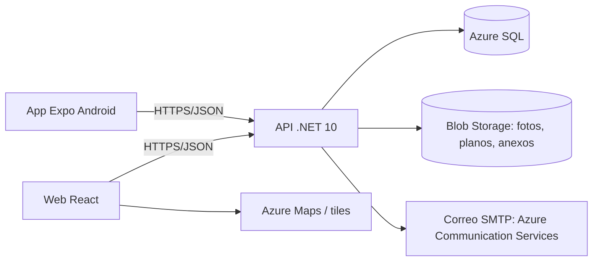

# Arquitectura

| Ambiente | Base de datos | Archivos | Correo |
|---|---|---|---|
| Local | SQL Server en Docker | Azurite | Mailpit (http://localhost:8025) |
| Pruebas / Producción | Azure SQL | Azure Blob Storage | Azure Communication Services (SMTP) |

## API (Clean Architecture)
- `Domain`: entidades y reglas. Sin EF ni ASP.NET.
- `Application`: casos de uso e interfaces (`IUsuarioActual`, `IAlmacenArchivos`, `IServicioCorreo`).
- `Infrastructure`: `AppDbContext`, configuraciones EF, `AuditoriaInterceptor`, Blob, SMTP, `AddInfraestructura()`.
- `Api`: endpoints (minimal APIs agrupadas por módulo), CORS, OpenAPI en `/openapi/v1.json`, `/health`.

### Convenciones de la API
- Un archivo de endpoints por módulo: `Api/Endpoints/<Modulo>Endpoints.cs` con `MapGroup("/api/<modulo>")`.
- DTOs de entrada y salida separados de las entidades; los mismos tipos se replican en `packages/shared` con Zod.
- Errores con `ProblemDetails`. Validaciones del dominio lanzan `ArgumentException` o una excepción de dominio que se traduce a 400.
- Fechas en UTC en la base; la web y la app muestran hora de Colombia (America/Bogota).

## Web
- React Router para pantallas, TanStack Query para datos del servidor, Zustand solo para estado de UI.
- Estructura sugerida: `src/modulos/<modulo>/` (páginas, componentes, hooks) y `src/lib/` (api, utilidades).
- Mapa: Leaflet + Geoman para dibujar rutas; GeoJSON hacia la API (longitud, latitud).

## App
- Expo Router (`src/app/` = pantallas). Ubicación solo en primer plano (`expo-location`), fotos con `expo-image-picker`, avisos con `expo-notifications`, token en `expo-secure-store`.
- La URL de la API sale de `EXPO_PUBLIC_API_URL`.
