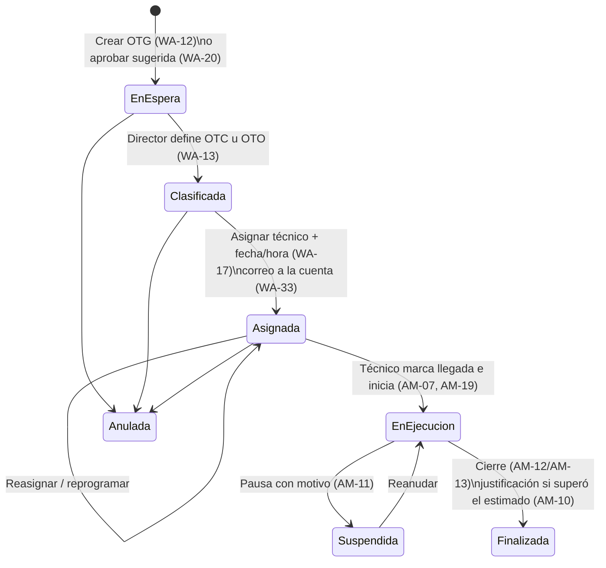
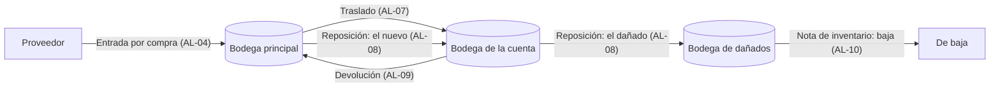
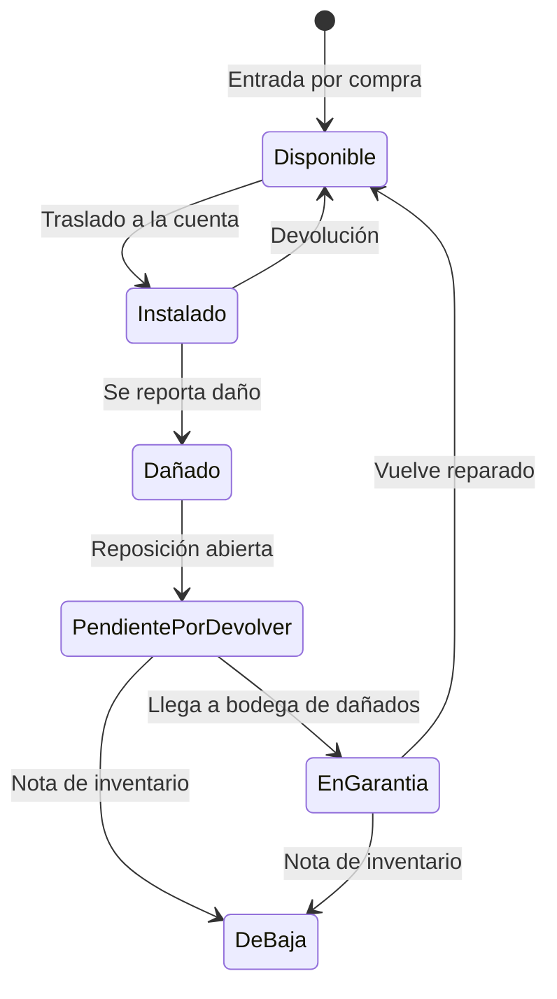

# Flujos principales

## 1. Ciclo de vida de una orden

Los estados definitivos se confirman en la fase 1 (WA-14).

## 2. Marcaciones del técnico en la app (GPS por acción)

| Marcación | Qué registra | Efecto |
|---|---|---|
| Inicio de jornada | Hora + GPS | Abre la jornada (IN-04) |
| Voy en camino | Hora + GPS | Correo a la cuenta (AM-21) |
| Llegada | Hora + GPS + distancia a la cuenta | Valida el perímetro; si está por fuera o fuera de hora → alerta (AM-18, WA-24) |
| Inicio de tarea | Hora + GPS | Arranca el cronómetro (AM-08, WA-35) |
| Pausa / Reanudación | Hora + GPS + motivo | El tiempo en pausa no cuenta (AM-11) |
| Cierre | Hora + GPS + formulario + fotos | Finaliza la orden; tiempos ganados/perdidos (IN-03) |
| Salida | Hora + GPS | Recorrido del día (WA-26) |
| Fin de jornada | Hora + GPS | Cierra la jornada |

**Tiempo real de la orden** = (cierre − inicio de tarea) − suma de pausas. Se compara con el tiempo estimado de la plantilla.

## 3. Inventario por bodegas

**Cómo nace un traslado**
1. El director técnico crea la **solicitud de inventario** ligada a una orden (AL-05).
   - O el técnico pide material extra desde la app (AM-20) → el director la aprueba (AL-06) → queda como solicitud de la orden.
2. El almacenista **despacha**: se genera el traslado de la bodega principal a la bodega de la cuenta y se registra la entrega en la app con foto (AL-07, AL-17).
3. Recuperables → quedan **Instalados** en la cuenta, con serial y zona. Consumibles → quedan **usados** (no vuelven, no quedan pendientes).

**Reglas**
- No se traslada más de lo disponible en la bodega de origen (AL-12).
- Cada tipo de documento tiene su consecutivo; los documentos no se borran, se anulan (AL-11).
- Existencias = suma de movimientos por artículo y bodega (kardex, AL-14).

## 4. Estados de un artículo recuperable (con serial)

